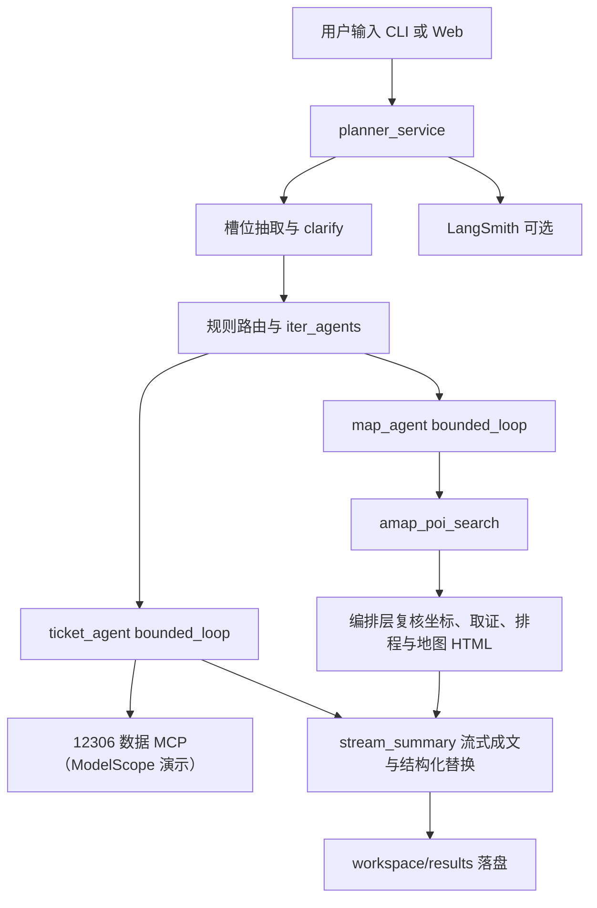

# 旅游规划多智能体


这个项目用旅行规划练多智能体编排里三件事：外部工具不可靠时怎么降级、成文阶段怎么拦住编造、子智能体执行时怎么挡住改文件和读密钥。一句自然语言需求，产出景点、路线地图和车票建议。

可交互架构图：[docs/travel-planner-runtime.html](docs/travel-planner-runtime.html)。说明见 [ARCHITECTURE.md](ARCHITECTURE.md)。评测见 [EVALS.md](EVALS.md)。

支持两种入口，共用同一套规划核心：

| 入口 | 命令 | 说明 |
|------|------|------|
| Web | `python -m uvicorn server:app --reload --reload-exclude workspace --host 127.0.0.1 --port 8000` | FastAPI + Vue3，SSE 流式进度 |
| CLI | `python app.py "你的需求"` | 控制台交互，支持澄清补槽 |

---

## 功能一览

- **自然语言理解**：抽取出发地、目的地、日期、天数、预算、偏好、节奏等槽位
- **人机确认（HITL）**：出发地 / 目的地 / 日期缺失，或多日行程缺住宿地时弹出确认卡；修订合并槽位后重新检查
- **地图子智能体**：仅用 `amap_poi_search` 检索景点候选；坐标复核、路线排程和地图 HTML 由编排层完成
- **车票子智能体**：接入提供 12306 数据的公开 MCP（ModelScope 演示端点）查车次与票价；不可用时降级，**禁止编造票务**
- **流式汇总**：按固定六章节输出 Markdown；落盘前校验章节，无可靠票务时禁止车次号，失败重试一次，仍失败则降级
- **用量**：`final.timings` 含 `prompt_tokens`、`completion_tokens`、`cost_usd`（单价见 `.env.example`，未配置时成本未知）
- **产物落盘**：方案写入 `workspace/results/`，地图写入 `workspace/results/maps/{plan_id}.html`
- **可选 LangSmith**：过程可视化追踪

---

## 架构



| 组件 | 职责 |
|------|------|
| `iter_agents` | 根据规则结果用 `asyncio` 启动 map / ticket；各自执行有界 `bounded_loop`（模型：DeepSeek `deepseek-flash`） |
| HITL | 关键槽位及多日住宿地齐全才继续；soft 槽位可默认。澄清结束本轮，确认后发起新请求 |
| `map_agent` | 景点检索。工具只有 `amap_poi_search`；路线、排程和地图 HTML 在编排层 |
| `ticket_agent` | 车次 / 票价。工具面只有 12306 MCP；同城或明确自驾等不挂载 |
| `stream_summary` | 无工具成文，校验失败最多重试一次；等待模型流超时则确定性降级 |

子智能体分开挂，是为了工具面隔离，不是为了多一段人设。当前路径不经 `create_deep_agent`，不向模型暴露文件系统或 shell；这是应用工具权限控制，不是操作系统级沙箱。见 [ADR-4](docs/adr/0004-subagent-is-tool-surface.md)。

---

## 快速开始

### 环境要求

- Python **3.11+**（推荐 Conda）
- 当前 Web / CLI 规划路径不需要 Node.js；单独运行保留的高德 Skill 脚本时才需要
- DeepSeek API Key、高德 Web 服务 Key
- 前端脚本在 `frontend/vendor/`，打开首页不依赖 unpkg

### 1. 克隆并安装 Python 依赖

```bash
git clone <你的仓库地址>
cd 旅行规划多智能体

conda create -n travel-planner python=3.11 -y
conda activate travel-planner
pip install -r requirements.txt
pytest -q -m "not integration"
```

先跑上面的 pytest，确认当前环境能过单元测试，再配密钥。

### 2. 配置密钥

```bash
# Windows
copy .env.example .env

# macOS / Linux
cp .env.example .env
```

编辑 `.env`（**切勿提交**）：

| 服务 | 申请入口 | 环境变量 |
|------|----------|----------|
| DeepSeek | https://api.deepseek.com | `OPENAI_API_KEY`、`OPENAI_BASE_URL=https://api.deepseek.com`（模型 `deepseek-flash`） |
| 高德 Web 服务 | https://lbs.amap.com/api/webservice/create-project-and-key | `AMAP_WEBSERVICE_KEY` |
| LangSmith（可选） | https://smith.langchain.com | `LANGSMITH_TRACING`、`LANGSMITH_API_KEY`、`LANGSMITH_PROJECT=travel-planner`；自动链接失败时再填 `LANGSMITH_ORG_ID` |

同文件里还有：`CORS_ORIGINS`（默认同源 `127.0.0.1:8000`）、`MCP_12306_URL`（不填则用 ModelScope 演示端点）、`PLAN_BUDGET_SECONDS`（默认 240，最后 10 秒只收尾）、`PLAN_MAX_INFLIGHT`（默认 2）、`PLAN_RATE_PER_MINUTE`（默认每分钟 8 次）、`PLAN_API_KEY`（设置后启用访问口令）、`PLAN_SESSION_TTL_SECONDS`（默认 8 小时）和 `PLAN_COOKIE_SECURE`（HTTPS 部署必须为 `1`）。页面用口令换取 HttpOnly 会话；脚本客户端可继续用 `X-API-Key`。未配置 `PLAN_API_KEY` 时保留本机免认证。`TOKEN_USD_PER_M_IN` / `TOKEN_USD_PER_M_OUT` 是每百万 token 美元单价，未配置时费用显示「成本未知」。

当前 HTTP 地图工具从服务端环境变量读取高德 Key，不读取历史 Skill 的 `config.json`。`MCP_12306_URL` 的默认地址在 `planner/ticket_agent.py`。

真实黄金集不进 CI。用 `python -m evals.run_golden --as-of 2026-11-14` 可复现一轮日期输入：它固定使用 `Asia/Shanghai`，并把相对日期解析为严格晚于基准日的下一个周六；缺密钥、授权或费用前置条件时会明确记录为 `blocked`，不会伪装成通过。浏览器 iframe 的人工验收清单与固定本地夹具位于 `evals/MANUAL_BROWSER_ACCEPTANCE.md` 和 `evals/fixtures/browser-map.html`。

### 3. 启动

**Web（推荐）：**

```bash
python -m uvicorn server:app --reload --reload-exclude workspace --host 127.0.0.1 --port 8000
```

浏览器打开：http://127.0.0.1:8000/

**CLI：**

```bash
python app.py "这周六从新乡坐高铁去郑州一日游，预算 500，少折腾"
python app.py   # 交互输入
```

规划结果示例路径：

- `workspace/results/旅游规划-YYYY-MM-DD-HHMMSS.md`
- `workspace/results/maps/{plan_id}.html`（用户未声明不要地图时必须生成）

浏览器仍使用既有 `/results/...` 链接读取 Markdown 与地图，但它们已由受控路由按同一认证规则提供；快照、SQLite 数据库及其辅助文件没有 HTTP 路由。对外部署必须启用 HTTPS、`PLAN_COOKIE_SECURE=1`，并配置受限的 `CORS_ORIGINS`。

---

## 端到端验收场景

Web 首页示例与下列场景一一对应：点「跨城高铁」「租电车自驾」「车票查不到」「修订方案」会填入需求并展示一份写好的详细示例；点「开始规划」才真实查询。「只说目的地」只填入缺信息的短句。出发地和出行方式写在用户话里。

1. **跨城高铁（并行）**：`这周六从新乡坐高铁去郑州一日游，预算 500，少折腾` — 看 map 与 ticket 由代码并发启动。
2. **省内租电车自驾（两轮）**：`下周从新乡租电车自驾去洛阳两天，轻松点，别安排开封和宝泉` — 两天行程没说住宿地，第一轮停在确认卡要求补住宿地；补上后第二轮 ticket `skipped`，方案考虑续航/充电。
3. **HITL**：`周末去郑州玩` — 缺出发地或日期时弹出确认卡。
4. **MCP 降级**（开发）：把 `.env` 里 `MCP_12306_URL` 改成无效地址后重跑跨城高铁 — `unavailable`，车票节说明服务不可用且不编车次。首页「车票查不到」只展示这时的成文，不写配置步骤。
5. **修订**：在第 2 条完成后提交「不要龙门石窟，改白马寺，路线顺一点」— 不重查票。

杭州→苏州可作为跨省对照。

### 耗时预算

工作预算默认 240 秒，最后 10 秒只做确定性降级、落盘和本请求的连接清理。外部调用和模型调用使用截止前的剩余时间。票务连接按请求创建，握手时间算在票务阶段里，不再复用进程内客户端。地图相关的三件事分开判：`need_poi_search`（要不要检索景点）、`need_route`（行程里要不要排路线）、`need_map_artifact`（要不要写地图 HTML 产物）。「不要地图/不要路线图」只否决产物，行程表照旧结构化生成；「不要找景点/不要景点」才连检索和排景点一起停（`planner/routing.py` 的 `map_scope()`）。

`FORCE_SERIAL=1` 时代码先跑票务再跑地图，不靠提示词。[EVALS.md](EVALS.md) 的旧流水线对照数字只作历史，不能当成当前性能。

对抗用例只证明控制层会拦住这些字符串。模型会不会照着恶意指令做，这组用例没有证明。其余边界见下方「已知边界」。

快照在 `workspace/results/snapshots/`（已 gitignore）。**不做自动 LRU**；目录膨胀时本地手动清理即可。

---

## SSE 事件协议

`POST /api/plan`

请求体：

```json
{
  "query": "自然语言需求",
  "slots": null,
  "plan_id": null,
  "mode": "plan",
  "lodging_scope": null,
  "party_size": null,
  "budget_scope": null,
  "cleared_fields": [],
  "intent_source": "initial",
  "intercity_mode": null,
  "return_required": null
}
```

- `mode`：`plan`（首次规划）/ `revise`（按修订意见重跑，须带 `plan_id`）/ `confirm`（补充与确认卡提交，须带 `plan_id` 与合并后的 `slots`）。`confirm` 会先与上一版槽位求差，再按「改了什么」重判走查票、出地图还是只重写正文，不会无条件复用上一版。
- 修订分支按「实际变化 + 本轮明确动作」判定：原话明确说「重新查一下余票」才重查票，「调整景点顺序」才重排；只改预算走 `budget_only`，只改措辞走 `summary_only`——两者都完整复用上一版行程、地图、约束与待复核标记，只重出正文。原话说出的人数（「改成三个人」）写回 `request_context.party_size`，父方案已选车次在本轮未点名且仍适用时沿用。
- `intent_source`：首次原话用 `initial`，自然语言修订用 `revision`，确认表单携带的旧需求用 `background`。后者不参与本轮交通意图判断；表单实际改动优先。
- `intercity_mode` 是跨城 `rail` / `driving` / `plane`，`return_required` 是是否往返；二者存于 `request_context`。`slots.transport_mode` 只表示市内游览方式，不能决定是否查铁路票。
- `lodging_scope`：`exact`（已给具体酒店）/ `area`（按该区域参考规划，不再追问）；`party_size` 为人数；`budget_scope` 为 `total` / `per_person`。缺省表示本轮未确认，保留上一版的确认状态。
- `cleared_fields`：显式撤销某几项确认（例如 `["lodging_scope"]`）。撤销会跨轮保留并阻止历史原话回填，直到用户重新显式提供值；清空住宿口径也会作废住宿类型并重算地图。

确认卡回传时带上已校验的 `slots`。响应为 `text/event-stream`，每帧：`data: {json}\n\n`。

| type | 主要字段 | 含义 |
|------|----------|------|
| `status` | `message` | 进度文案 / 抽取失败降级提示 |
| `slots` | `slots` | 抽取或已确认的槽位 |
| `clarify` | `slots`, `missing`, `pending`, `defaults_applied`, `message` | 关键槽位或多日住宿地缺失，等待确认。`pending` 是「点一下才算确认」的项（住宿只到区域 / 人数 / 预算口径） |
| `step` | `id`, `status`, `elapsed_ms?`, `reason?`, `label?` | `understand` / `ticket` / `map` / `summary`；`skipped` 不带 `elapsed_ms`；`reason` 如 `no_rail_intent` / `mcp_unavailable` / `not_dispatched` / `route_no_rail` / `route_no_map` / `user_no_map`（不要地图：仍排行程，只是不出地图产物）/ `user_no_poi`（不要景点：不检索也不排景点）/ `user_no_route`（不查路线：景点与行程照旧，但不查交通耗时）/ `reuse_parent`（本轮完整沿用上一版，既没查票也没出图） |
| `warning` | `code`, `message`, `kind?`, `ref?`, `reason?` | 漏调度 map/ticket 等护栏，以及未定位、限流、额度用完等原因。同一 `code + ref + kind` 只会有一条 |
| `final` | `content`, `saved_url`, `plan_id`, `timings`, `quality`, `request_context`, `cleanup`, `map_url?`, `trace_url?` | 完整方案、耗时、token 与产物链接。`timings.summary_gate` 为 `pass` / `retry_pass` / `degraded`；`timings.run_stats` 是本轮各环节的尝试结果（见下方「请求级运行统计」），只存状态与计数，不含 query、工具原始响应或模型全文；`cleanup` 是发 `final` 之前完成的清理结果（见下方「清理结果」） |
| `subagent` | `name` | 调度的子智能体 |
| `tool` | `name`, `args` | 工具调用 |
| `tool_result` | `content` | 工具返回（已截断） |
| `model` | `content` | 旧调度器的兼容事件，当前主路径不依赖 |
| `token` | `content` | summary 增量文本 |
| `error` | `message`, `code?`, `cleanup?` | 失败。`code=sse_timeout` 表示整条流超过 `SSE_TOTAL_TIMEOUT_SECONDS` 被中止，此时 `cleanup?` 带上生成器被 `aclose()` 时回填的清理结果（字段同 `final.cleanup`）。`error` 是终态：收到后不会再有 `final` |

`final.quality` 字段：

| 字段 | 说明 |
|------|------|
| `status` | `complete` / `partial` / `degraded`。有 `pending`（等你确认的项）时最高只到 `partial`，但 `checks` 保持真实核实结果，不为了降状态伪造未核实 |
| `checks` | `ticket` / `opening_rules` / `travel_time` / `schedule` / `budget`，取值为 `verified` / `unverified` / `conflict` / `not_required`。`travel_time` 另有 `reference` 档：路线查询成功但未带日期/时段，只能算参考 |
| `coverage` | `opening_rules` 与 `travel_time` 的分子分母；交通的「参考数」与「已核实数」分开统计，不合并成一个比例 |
| `issues[]` | 见下方 `final.quality.issues[]` 字段表 |
| `pending[]` | **只放需要你决定**的项：人数未定（`party_unknown`，`action=confirm_party`）、预算口径未定（`budget_scope_unknown`，`action=confirm_budget_scope`）、住宿只到区域（`lodging_area_pending`，`action=confirm_lodging`）。「市内交通、门票等费用未核实」属于系统待核实，记在 `issues[]` 的 `owner=system` 里，**不计入** `pending` 数量，`pendingCount` 也不会因此增加 |
| `notes[]` | 说明性内容，如票务工具未启用解析、沿用旧方案未复核 |
| `sources[]` | 查询依据：`label`、`tool`、`record_count`（查询次数）、`fact_count`（记录条数）、`queried_at`、`url`、`ref`；网页来源另有 `poi_ids` 与 `facts`，见下方「来源与景点的关联」 |
| `route_error` / `search_error` / `ticket_applicability` | 路线、开放规则、车次适用性的原始原因，供技术详情展开 |

`final.quality.issues[]` 字段：

| 字段 | 必填 | 说明 |
|------|------|------|
| `code` | 是 | 问题代码，取值见下方「issue 代码」 |
| `message` | 是 | 面向用户的短句 |
| `owner` | 是 | `user` / `system`。责任方：`user` 是「需要你补充或决定」，结果页归到「需要你补充」；`system` 是「查询/核实未完成」，归到「查询未完成」。`owner` 与 `kind` 正交，`kind` 仍只表示提示级别 |
| `kind` | 是 | `pending` / `warning` / `info`。**不能**单靠 `kind=pending` 判「要不要用户动手」，以 `owner` 为准 |
| `action` | 否 | 可点的动作。issue 里是 `confirm_lodging` / `select_return` / `recheck_tickets` / `rerun_route` / `view_opening` / `retry_lodging`；`pending[]` 里是人数的 `confirm_party` 和预算口径的 `confirm_budget_scope`。没有对应动作的项（如 `budget_unverified`）为 `null`。`retry_lodging` 在前端拆成两个按钮：「修改参考地点」（`retry_lodging_edit`，打开补充弹窗只改住宿描述，走 `mode=confirm`）与「重新定位」（`retry_lodging_now`，提交原话「重新定位住宿区域」走 `mode=revise`）；后端 `planner/routing.py` 的 `_explicit_lodging_relocate` 识别这句纯原话动作判为 `map_only`，真正重跑住宿定位与住宿往返接驳。两个按钮都由用户点击触发，前端不替用户自动重查地图 |
| `ref` | 否 | 关联对象标识（景点名、车次、日期等） |
| `options` | 否 | 返程车次候选数组，`select_return` 用它渲染可选项。元素含 `train_no`、`depart`、`arrive`、`from_station`、`to_station` |
| `items` | 否 | 未定位项明细数组，用于展开 `candidate_unlocated` / `lodging_*` 的具体对象 |
| `date` | 否 | 该条明细指向的日期（如缺开放规则、缺路段耗时的那一天）；`rail_window_unknown` 带的是该端对应的抵离日期 |
| `poi_id` | 否 | 该条明细指向的地点标识，可与 `itinerary.days` 里的 `poi_id` 对上。`opening_missing` 的景点名只写在 `message` 里，`poi_id` 只出现在 `ref` / `poi_id` / `detail` 中，不当正文文案 |
| `detail` | 否 | 补充说明，**字符串或对象**。对象形式前端逐行渲染，常见字段：`mode`（交通方式）、`depart`（出发时刻）、`state`（路线状态原值）、`reason`（失败原因码）、`reason_text`（原因中文）；`rail_window_unknown` 另有 `train_no` / `first_day` / `last_day`；住宿类另有 `scope` / `text` / `reason` |
| 其余附加字段 | 否 | 按 code 附带，前端不识别时忽略：`direction`（`rail_window_unknown` 指明去程/返程）、`leg`（`travel_leg_unknown` 的 `origin` / `dest` / `mode` / `depart`）、`date_label`（`opening_missing` 的「日期」文案）、`reasons`（`ticket_not_applicable` 的不适用原因列表） |

`owner` 在代码里是 `_ISSUE_OWNER` 映射的产物，`_issue()` 统一补上；`kind` 仍是 `_ISSUE_KIND`。同一个问题被两个阶段各报一次时，按 `code + ref + kind` 去重，页面上只出现一条。

issue 代码（`owner` 一列说明这条该谁处理）：

| code | owner | 含义 |
|------|-------|------|
| `lodging_area_pending` | `user` | 住宿只给到区域，需要你选：填具体酒店，或按该区域参考规划 |
| `lodging_unresolved` | `user` | 你给的酒店在高德匹配不上，出发与返回点暂按目的地中心代 |
| `lodging_anchor_missing` | `user` | 住宿区域参考点没有建立起来，住宿接驳无法进入路线查询 |
| `return_basis_pending` | `user` | 已查到返程候选但还没选定，需要你指定坐哪一趟 |
| `budget_unverified` | `system` | 预算口径或主要费用未核实。人数/口径缺失另有 `pending` 项承担，这条不算待确认 |
| `ticket_reused` | `system` | 沿用上次车次查询，余票未刷新，不是当前余票 |
| `ticket_unverified` / `ticket_not_applicable` / `ticket_empty` / `ticket_mismatch` / `unrecognized_ticket_payload` | `system` | 票务没查到、查到了但不适用、响应识别失败 |
| `opening_missing` | `system` | 具体景点在某一游览日缺开放规则。`message` 带「日期 + 景点名」（如「11 月 8 日：西湖，尚无适用于游览日期的开放规则」），`poi_id` 只出现在 `ref` / `poi_id` / `detail` 里，不写进文案 |
| `opening_unverified` | `system` | 开放规则的聚合结论，**其类别没有被明细覆盖**时才出现；被 `opening_missing` 覆盖时不重复 |
| `travel_leg_unknown` | `system` | 具体某段路耗时缺失（`date` 与 `ref` 指明路段）。`message` 按交通方式区分：步行写作「步行耗时未取得」、公共交通写作「公共交通耗时未取得」、驾车写作「驾车耗时未取得」、换乘写作「换乘耗时未取得」，`detail.mode` 带原始方式 |
| `travel_reference` | `system` | 耗时来自路线查询，未按时段核验，只能算参考 |
| `rail_window_unknown` | `system` | 抵离时刻未知，导致当天可用窗口无法计算（`rail_window` 的该端 `state` 是 `unknown`）。它顶替原来笼统的「排程仍有未知条件」，`direction` 指明是哪一端，`detail` 说明缺的是什么。`message` 按情形区分：「已选去程车次 … 缺少可用的抵达时刻」「已选返程车次 … 缺少可用的出发时刻」「去程车次尚未确定」「返程车次尚未选定 / 尚未确定」（后两者区别在于有没有候选，有候选时另有 `return_basis_pending` 请用户选） |
| `schedule_conflict` / `schedule_unverified` | `system` | 必去项未排入 / 排程仍有未知条件。`schedule_unverified` 只在「排程类别没有被明细覆盖」时出现 |
| `candidate_unlocated` | `system` | 有景点没能在高德定位，`items` 带明细 |
| `candidate_shortage` | `system` | 当前可用候选无法补足完整游览日；`detail.gaps` 说明日期与剩余游览缺口，`detail.supplement` 保留本轮补充的查询、取证与撤回统计 |
| `schedule_sparse` | `system` | 候选池尚可用但某完整日游览负荷偏少；仅在没有 `candidate_shortage` 父问题时显示。抵离窗口未知或纯抵离日不按完整日密度告警 |
| `summary_degraded` | `system` | 成文未通过校验，已改为确定性说明 |

结果页将交通耗时、开放规则与单次空查询按类别计数并默认折叠，展开后保留日期、来源、原因及操作。用户确认项、抵离窗口未知与排程冲突保持可见。明确的「没有查询到相关车次信息」属于空结果（非售罄、非解析失败），单次空结果不覆盖其他查询产生的适用事实。

**票务告警按真实状态分流。** `checks.ticket` 在复用场景仍然是 `unverified` —— 判据是「本轮是否核实过」，不是「有没有车次」。分流规则（`planner/quality.py` 的 `_ticket_issues`）：

| 场景 | 输出 | 文案要点 |
|------|------|----------|
| 复用，且有适用事实 | `ticket_reused` | 「沿用上次车次查询（查询时间 …），余票未刷新，不是当前余票」 |
| 复用，但事实全不适用 | `ticket_not_applicable` | 带 `reasons`；区间/日期不成立 |
| 复用，事实为空且父方案查询失败/无结果/超时 | `ticket_unverified` | 保留原失败语义（失败 / 无结果 / 超时），并注明「本轮沿用该结果，余票未刷新」 |
| 本轮查票 `ok` 且有适用事实 | 无票务 issue | — |
| 方案不依赖铁路（`skipped`） | 无票务 issue | — |

**复用的三种口径并存，不能互相顶替。** 复用轮的面子状态是 `reused`，但父方案实际是怎么结束的，必须原样留住：

| 字段 | 存放位置 | 含义 |
|------|----------|------|
| `parent_reason` | 快照 `ticket_reuse.parent_reason`；质量侧 `ticket_state.parent_reason` | 父方案那次查询的**原始结论**（`ok` / `skipped` / `unavailable` / `missed` / `timeout` / `reused`），从不改写成新状态 |
| `parent_class` | 质量侧 `ticket_state.parent_class` | 给质量聚合用的分类：`ok` / `skipped` / `failed` / `unknown` |
| `reuse_source` | 快照 `ticket_reuse.reuse_source`；正文措辞 | 面向正文与前端：`parent_ok` / `parent_skipped` / `parent_failed` / `parent_reused` / `parent_unknown` |

父方案本身也是复用来的（`parent_reason=reused`）时，只有快照里存下的那层原始结论还留着最初这次查询的真实原因；丢了这层，孙代就会把「最初查失败」说成「沿用上次结果」。所以复用分支一律经 `planner/pipeline.py` 的 `_reuse_state()` 取值，正文分别说「上次查询成功，余票未刷新」「上次查询失败（服务不可用 / 未调度 / 超时），本次未重新查询，余票未知」「上次没有查票」；旧快照没有 `ticket_reuse` 字段时按 `parent_unknown` 兼容，不会凭空断言成功。

调度层面，复用轮既没连票务也没跑地图，`ticket` 与 `map` 两个 step 统一发 `reason=reuse_parent`，不写成 `route_no_rail` / `route_no_map`——那两个码的含义是「本轮判定不需要」，与「完整沿用上一版」是两件事。

**明细聚合按类别覆盖，不再「有任意明细就压掉聚合项」。** 每条明细声明自己覆盖哪个类别：`travel_leg_unknown` → `travel_time`，`opening_missing` → `opening_rules`，`rail_window_unknown` / `candidate_shortage` / `schedule_sparse` → `schedule`。只有该类别**被明细覆盖**时才省略对应的 `travel_unverified` / `opening_unverified` / `schedule_unverified`；没被覆盖到的类别照旧输出聚合项（`budget_*`、`schedule_conflict`、`ticket` 不受明细影响）。

`final.timings.run_stats` 是请求级运行统计，由各层在发生位置自己写入，最后统一序列化（`planner/run_stats.py`）：

| 键 | 覆盖的环节 |
|------|------|
| `ticket_connect` / `ticket_query` | 票务 MCP 连接、单次工具查询 |
| `map_poi` / `map_route` | 高德 POI 检索与路线查询 |
| `evidence_search` | 开放规则检索 |
| `subagent` | 子智能体整体调度 |
| `sse` | SSE 外层（超时、客户端断开） |

每个键的取值是 `attempted` / `succeeded` / `failed` / `timed_out` / `cancelled` / `rate_limited` / `blocked_by_budget` / `dependency_missing` / `not_needed`。这九档的区别是必要的：`tool_attempts=0` 不能告诉你究竟是「本轮没必要调用」「被预算拒绝」「依赖没装」「用户取消」还是「路由跳过」。清理阶段留下痕迹时另记 `notes`，例如 `subagent_leak:map`（清理窗口内子任务仍未结束）与 `mcp_closed_after_timeout`（MCP 是在子任务残留状态下关闭的）。

#### 清理结果（`cleanup`）

`final.cleanup`、`error.cleanup` 与 `timings.run_stats.cleanup` 是同一份结果，由 `planner/pipeline.py` 的 `_finalize_cleanup()` 产出，**幂等**：正常路径在发 `final` 之前调用一次，`finally` 再兜底一次，重复调用不重复关闭。

| 字段 | 说明 |
|------|------|
| `drain_started` / `drain_completed` | 是否进入并完成了子任务回收等待 |
| `subagent_leak` | 清理窗口结束时仍未结束的子任务名；空数组表示没有残留 |
| `mcp_close_started` | 本轮是否真的持有需要关闭的 MCP 连接（没有连接时为 `false`，不编造「已关闭」） |
| `mcp_close_completed` / `mcp_close_error` | 关闭是否成功；失败时保留异常文案，不吞掉 |
| `mcp_closed_after_timeout` | MCP 是否在有子任务残留的情况下被关闭 |

**为什么 `cleanup` 是顶层字段而不是只写进 `run_stats.notes`：** `timings.run_stats` 是 `as_dict()` 的快照拷贝，字段一旦构造完就固化了；而清理发生在发 `final` 之前和 `finally` 里，只有顶层字段才能保证发送出去的事件一定带着它。SSE 总超时或客户端断连时，`server.py` 从同一个 `RunStats` 对象读出 `cleanup` 补进 `error` 事件——这条路径上没有 `final` 可发，日志之外必须有一个结构化出口。

`final.request_context` 是本轮实际生效的口径（`planner/pipeline.py` 的 `final_event`），前端重开「补充与确认」时用它还原表单：

| 字段 | 说明 |
|------|------|
| `party_size` | 本轮生效人数（含本轮原话说出的数字，如「改成三个人」）；未知为 `null` |
| `budget_scope` | `total` / `per_person`；未知为 `null` |
| `lodging_scope` | `exact` / `area`；未知为 `null` |

**复用分支同样要重算依据与 `rail_window`。** 命中 `summary_only` / `budget_only` / `map_only` 的复用路径不会跳过这两步：先按本轮槽位与已验证事实重建 `plan_basis`，再据此重算 `rail_window`。`rail_window` 是**派生结果**，只要依据变了（点了新车次、改了返程时段、日期或天数变化）就必须重算，不能把父方案窗口照抄下来，否则排程会按旧的抵离时刻安排当天行程。

**父方案的事实先重验，再进依据。** 复用会继承父方案的票务事实，但这些事实的 `direction` / `applied` / `reason` 是按**旧日期与旧区间**算出来的。进入本轮规划依据前必须按当前 `expect_date` / `return_date` 重新验证（重新判定方向、是否适用及原因），不能直接沿用快照里的 `applied=True`。只有行程条件确实没变（日期、区间、出行方式一致）时才允许沿用事实本身。

#### 来源与景点的关联

网页来源行（`sources[]` 里带 `url` 的那些）除公共字段外还有两个字段，用来把「开放规则依据」挂到具体景点上：

| 字段 | 类型 | 说明 |
|------|------|------|
| `poi_ids` | `string[]` | 这份来源覆盖到的景点编号，可跨多个景点 |
| `facts` | `object[]` | 逐条依据：`poi_id`、`kind`（如 `opening_hours` / `last_entry` / `closed_weekday` / `closed_date`）、`quote`（原文片段）、`status`（`hard` / `pending`）、`applies_on`（适用日期，可缺）、`weekdays`（适用星期，可缺） |

前端匹配规则：按 `poi_id` **加上适用日期**去匹配，**不再把来源编号当景点编号**。同一 URL 覆盖多个景点时全部保留，不折叠成一条；找不到匹配时显示「尚无可用依据」，不拿不相关来源凑数。


其它 HTTP：

| 方法 | 路径 | 说明 |
|------|------|------|
| GET | `/` | 前端首页 |
| GET | `/api/health` | 仅检查进程存活，不访问外部网络 |
| GET | `/api/ready` | 必需配置与 MCP 短超时 HTTP 探测；不验证工具协议和真实查询成功，MCP 不可达时可降级 |
| GET | `/api/plans` | 最近规划记录（延迟与状态）。设置 `PLAN_API_KEY` 时同样要求 `X-API-Key` |
| GET | `/results/...` | 方案 / 地图静态文件 |

---

## 目录结构

```text
旅行规划多智能体/
├── planner_service.py      # 对外 API（CLI / Web / 测试入口）
├── planner/                # 规划实现（改逻辑看这里）
│   ├── pipeline.py         # 一次规划的事件流
│   ├── plans_store.py      # 规划记录（SQLite，失败不影响规划）
│   ├── subruns.py          # asyncio 调度与子任务有界工具循环
│   ├── dispatch.py         # 旧主智能体事件适配，当前主路径不使用
│   ├── routing.py          # 查票 / 出地图 / 修订路由
│   ├── map_agent.py        # 地图子智能体
│   ├── ticket_agent.py     # 车票子智能体（ModelScope 上的 12306 数据 MCP）
│   ├── ticket_cache.py     # 按请求创建和关闭 MCP 连接
│   ├── summary.py          # 汇总成文与落盘
│   ├── prompts.py          # 槽位抽取与历史主智能体提示词
│   ├── llm.py              # 模型与槽位抽取
│   ├── backends.py         # 历史文件系统/shell 支持，当前主路径不使用
│   ├── async_utils.py      # 可取消、可超时的异步迭代
│   └── paths.py            # 路径、编码、LangSmith
├── slots.py                # 槽位模型与相对日期解析
├── app.py                  # CLI 入口
├── server.py               # FastAPI + SSE
├── frontend/               # 页面
│   ├── index.html          # 结构
│   ├── app.js              # 交互与 SSE
│   ├── samples.js          # 首页验收场景稿
│   ├── map.js              # 高德链接与路线预览
│   ├── style.css
│   └── vendor/             # Vue、marked、DOMPurify
├── amap-lbs-skill/         # 保留的高德 Skill 脚本；当前模型不挂载 shell
├── evals/                  # 单元 / 集成评测（说明见 EVALS.md）
├── docs/adr/               # 架构决策
├── ARCHITECTURE.md
├── EVALS.md
├── LICENSE
├── workspace/
│   ├── config/memory/      # 保留的配置目录；不代表当前有长期记忆机制
│   └── results/            # 方案 md、maps/、snapshots/（内容 git 忽略，目录有 .gitkeep）
├── .github/workflows/ci.yml
├── requirements.txt
├── pytest.ini
├── .env.example
├── .gitignore
└── README.md
```

运行入口是 `server.py` / `app.py`。规划逻辑在 `planner/`，高德脚本在 `amap-lbs-skill/`。

---

## 评测

```bash
# 默认 CI（.github/workflows/ci.yml，Python 3.11 / 3.12）：纯函数 + mock，无网络
pytest -q -m "not integration"

# 集成：需 .env 中 DeepSeek Key
pytest -m integration evals/test_integration.py -q
```

覆盖点概要：

- critical / soft 分级与 `should_clarify`
- 相对日期换算（可注入 `today=`）
- `TravelSlots` 校验
- 方案六章节结构；无票时「车票建议」禁车次
- 票务六态（`ok` / `skipped` / `unavailable` / `missed` / `timeout` / `reused`）与路由注入
- `stream_plan` 并行调度、自驾跳过查票、修订 map_only（mock）
- 修订当前意图优先、延长为多日后重新澄清住宿、确认槽位继续规划
- 成文首段和后续段等待超时关闭模型流，使用已有结构化数据降级收尾
- 黄金集保留失败样本并执行 `expect`；离线回放在成功或异常后恢复临时替换并清理产物

口径见 [`evals/cases.md`](evals/cases.md)。闸门与失败注入见 [`EVALS.md`](EVALS.md)。

---

## LangSmith（可选）

在 `.env` 中设置：

```bash
LANGSMITH_TRACING=true
LANGSMITH_API_KEY=your_langsmith_api_key
LANGSMITH_PROJECT=travel-planner
```

未配置 Key 时 tracing 关闭，规划照常运行。配置后可在 https://smith.langchain.com 查看嵌套 trace；Web 结果区也会出现追踪链接（能生成 URL 时）。

---

## 设计要点与降级策略

1. **车票不可用**：MCP 超时或失败 → 跳过 `ticket_agent`，方案中如实说明，不编造车次
2. **成文闸门**：车票、预算、行程表先由结构化数据替换。六章节仍缺失，或替换后仍出现原文里没有的车次号 → 重试一次；仍失败则落盘降级说明（`summary_gate=degraded`）
3. **无需铁路**：同城游 / 明确自驾地铁航空等 → `ticket` 步骤 `skipped`（`reason=no_rail_intent` 或 `intra_city`），文案为「未查票（无需铁路）」
4. **本应查票未调度**：`missed` + SSE `warning`，汇总禁止编造
5. **槽位抽取失败**：先用规则兜底；兜底后仍缺关键字段或多日住宿地时发送澄清并结束本轮，不启动票务、地图、子任务或成文
6. **客户端断开**：Web SSE 通过 `cancel_event` 尽快停止后续 LLM 调用，节省费用
7. **工作截止**：截止后不再发起外部请求或模型调用，用已有结构化数据收尾
8. **出行日期未定**（`schedule_status=date_unknown`）：底层排程允许 `date=None` 的 days，不再伪造「首个整天」。此时当天可用窗口是 `unknown`、开放规则按「未核实」记录、候选缺口与密度目标都返回未知而不是按假日期算出来的数字。规划主流程仍要求关键槽位齐全，缺日期先走澄清，不会带着未知日期直接出正式方案。
9. **工具白名单**：地图只有 `amap_poi_search`，票务只挂查询工具。不把 shell 交给这两个子任务
10. **限流与认证**：`POST /api/plan` 默认每分钟 8 次，同时最多 2 个规划（单进程内存计数）。设置 `PLAN_API_KEY` 后，`POST /api/session` 可建立 8 小时的内存会话；错误的显式 `X-API-Key` 不会被 Cookie 掩盖。Cookie 写请求校验 `Origin`，进程重启或口令轮换会使会话失效。
11. **子任务与连接收尾**：取消时先 cancel 子任务并等待收尾，再关 MCP；清理窗口（`PLAN_CLEANUP_SECONDS`，默认 5 秒）内仍活着的任务记 `subagent_leak`，此时关闭 MCP 另记 `mcp_closed_after_timeout`，不会宣称资源已完全释放。工具调用本身也带超时（`TICKET_TOOL_TIMEOUT_SECONDS`），避免只取消到包装层。
12. **修订优先级**：本轮 `revision` 原话优先，确认表单实际改动覆盖同轮内容，`background` 旧原话只作历史背景；修订后统一复查缺失字段
13. **成文闸门双层**：车次号靠结构化白名单正则拦住；景点名、游玩耗时与先后顺序靠 `itinerary` 生成的白名单逐项比对（`planner/summary.py` 的 `poi_gate_issues`）。有结构化行程时「景点建议」整节由 `days` 确定性生成，模型写的景点内容随之作废——闸门只做最后检查，不承担事实替换。


---

## 已知边界

- **Judge 自偏好**：`python -m evals.judge` 与被评模型是同一个网关模型。分数对照 snapshot 里的工具原文，不能当成独立评审。
- **路由不泛化**：要不要查票、要不要出地图靠槽位和关键词（[ADR-2](docs/adr/0002-routing-is-rules.md)）。新说法要加关键词，不会自动泛化。
- **规划路径不再向模型提供 shell**。地图检索是一个校验过参数的 HTTP 工具。ADR-3 记录的是旧的宿主机 shell 边界，当前流水线不走那条路。
- **票务数据源是演示端点**：默认 12306 MCP 在 ModelScope，不是正式购票接口。
- **票务连接**：每次规划自己创建和关闭，不在进程内缓存。
- **`FORCE_SERIAL=1`**：代码先跑票务，再跑地图。
- **并行开始时间**：`map_ms` 和 `ticket_ms` 是各自子任务的耗时。`map_ticket_active_delta_ms` 用两侧真正开始的时间，而不是调度开始前统一记下的时间。

## 安全说明

- 本仓库**不包含**真实 API Key
- 请用 `.env.example` 复制为本地 `.env`，且确保 `.env`、`amap-lbs-skill/config.json` 已被忽略
- 前端不持有任何密钥；密钥仅存在于服务端环境变量
- 提交 GitHub 前请执行 `git status`，确认没有误加密钥文件

---

## 常见问题

**Q: `uvicorn` 命令找不到？**  
用 `python -m uvicorn ...`，避免 Conda 环境 PATH 未生效。

**Q: 只有景点没有车票？**  
检查网络与 ModelScope MCP 是否可达；服务不可用时会自动降级。

**Q: 地图空白？**  
确认服务端 `AMAP_WEBSERVICE_KEY` 有效、高德请求可达，并查看本次方案中的未知条件与告警。

**Q: Windows 中文乱码？**  
项目启动时会尽量将 stdout/stderr 设为 UTF-8；请使用 UTF-8 终端。

---

## License

本仓库代码采用 [MIT License](LICENSE)。`amap-lbs-skill/` 使用该目录自带的 MIT 许可证（版权：高德地图开放平台），以该文件为准。
